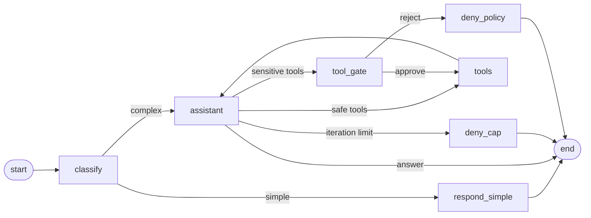

# LangGraph HITL Agent

A LangGraph agent served over FastAPI with streaming responses, human approval for tool calls with side effects, and per-user conversation threads persisted in Postgres.

The companion web client lives in **[langgraph-hitl-agent-ui](https://github.com/Witek-Witek/langgraph-hitl-agent-ui)**.

## Highlights

- **Human-in-the-loop approval.** Tool calls marked as sensitive pause the graph with `interrupt()`. The user sees the exact call and arguments, approves or rejects, and the run resumes with `Command(resume=...)`. Rejected calls are closed with error `ToolMessage`s, so the message history stays valid for every provider.
- **Streaming over SSE.** Tokens, tool start/end, approval requests and completion arrive as typed events. A heartbeat keeps flowing while the model is still thinking, so the client can tell a slow model from a dead connection.
- **Durable threads.** State is checkpointed in Postgres (`AsyncPostgresSaver` on a connection pool). An interrupted run can be resumed or finished after a server restart.
- **Authentication and ownership.** Every request carries a Supabase JWT, verified locally against JWKS. Each thread has an owner; ownership is checked before any checkpoint is read, and someone else's thread answers `404`, not `403`.
- **Provider-agnostic model layer.** Models are resolved from `provider:model` strings with `init_chat_model` (Anthropic, OpenAI, OpenRouter, any OpenAI-compatible endpoint). Switching provider is a configuration change.
- **Per-request model and persona.** The client picks a model profile and a persona per request through a typed run context (`context_schema`). It sends only catalog keys; the server owns the model specs, API keys and prompts.

## Graph



- `classify` routes with a cheap model; simple questions skip the tool loop.
- `assistant` runs a ReAct loop with a hard cap on tool iterations.
- `tool_gate` interrupts only when a batch contains a sensitive tool, and the decision covers the whole batch.

## Tech stack

Python 3.12 · LangGraph · LangChain · FastAPI · sse-starlette · PostgreSQL (Supabase) · psycopg 3 · PyJWT · LangSmith · uv

## Project layout

```
graph.py, nodes.py, routing.py, state.py   graph topology, nodes, routing, state schema
context.py, prompts.py, llm.py             run context, layered prompts, model catalog and factories
tools.py                                   tools and the sensitive-tool policy
auth.py                                    JWT verification against Supabase JWKS
threads_repo.py                            per-user thread registry
db.py                                      connection pool and Postgres checkpointer
server/app.py                              FastAPI app and lifespan
server/chat.py                             SSE streaming, resume, finish, state, history
server/threads.py                          thread CRUD
server/scoping.py                          checkpoint key construction
sql/001_threads_and_rls.sql                thread table and row-level security
run.py, repl.py                            command-line client (no auth, for local use)
diagnostics.py                             manual configuration and connectivity checks
```

## Getting started

**Prerequisites:** Python 3.12, [uv](https://docs.astral.sh/uv/), a Supabase project (Postgres and Auth), and an API key for at least one model provider.

```bash
uv sync
cp .env.example .env          # fill in keys, DATABASE_URL, SUPABASE_URL
uv run python serve.py        # first start creates the checkpointer tables
```

Then, in the Supabase SQL Editor, run `sql/001_threads_and_rls.sql` (idempotent). Create users under **Authentication → Users → Add user** with *Auto Confirm* enabled.

```bash
uv run python diagnostics.py  # verify configuration, models, database, auth
uv run python run.py          # optional: command-line client
uv run langgraph dev          # optional: LangGraph Studio
```

## API

All endpoints except `/health` require `Authorization: Bearer <Supabase access token>`.

| Method | Path | Purpose |
|---|---|---|
| `GET` / `POST` | `/threads` | List or create the caller's threads |
| `PATCH` / `DELETE` | `/threads/{id}` | Rename or delete a thread |
| `POST` | `/chat/stream` | Send a message, receive an SSE stream |
| `POST` | `/threads/{id}/resume` | Approve or reject a pending tool call |
| `POST` | `/threads/{id}/finish` | Complete a run interrupted by a restart |
| `GET` | `/threads/{id}/state` | Whether the thread is idle, awaiting approval, or interrupted |
| `GET` | `/threads/{id}/history` | Message history with tool calls |
| `GET` | `/config/options` | Available model profiles and personas |
| `GET` | `/health` | Liveness check |

SSE events: `token`, `tool_start`, `tool_end`, `gate`, `done`, `error`, `heartbeat`.

Operations that do not match the thread's state return `409`: a new message while approval is pending, a resume with nothing to resume.

## Security notes

- The checkpoint key is `user_id:thread_id` and is built in one place on the server. The client only ever sees `thread_id`.
- Row-level security is enabled **with no policies** on all public tables, and the Supabase Data API is disabled. The backend connects as the table owner; the `anon` and `authenticated` roles see nothing. The advisor warning `rls_enabled_no_policy` is intentional.
- Accepted JWT algorithms are an explicit list, never read from the token header. An invalid token returns `401`; an unreachable key set returns `503`, so the client does not sign the user out during an outage.

## Known limitations

- Local JWT verification cannot see sessions revoked in the Supabase dashboard; a token stays valid until it expires (about one hour).
- Deleting a thread removes it from the registry but leaves its checkpoints in the database, unreachable.
- Some models routed through OpenRouter occasionally return tool-call tokens as plain text.

## Development

The project is built in stages, each adding one capability. Every completed stage is tagged (`stage-11`, …), so any stage can be checked out on its own.

## License

[MIT](LICENSE)
